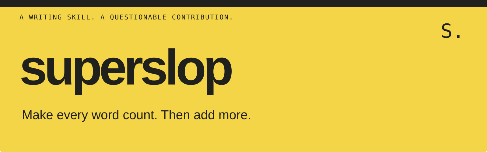

# superslop

A writing skill that makes your text sound aggressively AI-generated. On purpose.

Most writing skills remove the slop. This one gives it a promotion.

## Watch a typo become a milestone

**Before**

```text
I fixed the typo.
```

**After**

> **A Single Typo. A Transformative Milestone.**
>
> Absolutely! I fixed the typo—a pivotal step in the ongoing journey toward
> clarity, precision, and thoughtfully crafted communication; a small edit
> with an extraordinary sense of occasion.
>
> The result… not just a correction. A powerful testament to the transformative
> potential of getting a word right.
>
> **The key takeaway:** In an ever-evolving landscape of letters, meaningful
> progress begins one carefully considered character at a time.

An illustrative example. Actual output varies by model and prompt.

## Install

With [Node.js 22.20 or later](https://github.com/vercel-labs/skills#install-a-skill),
run this from the project where you want to use the skill:

```sh
npx skills add bedar89/superslop --skill superslop
```

Choose your agent in the installer. Installation is project-local by default.
The installer is provided by [Skills CLI](https://github.com/vercel-labs/skills).

<details>
<summary>Prefer to copy the file?</summary>

Create a `superslop` folder in your agent's skill directory. Copy
[SKILL.md](SKILL.md), [LICENSE](LICENSE), and [NOTICE.md](NOTICE.md) into it.
Keep the three files together so the upstream copyright and permission notice
travel with the skill. Follow your agent's documentation for its skill directory
and reload requirements.

The skill itself is Markdown. It has no hooks, API keys, or runtime dependencies.

</details>

## Put it to questionable use

Ask your agent:

```text
Use superslop to rewrite: "I fixed the typo."
```

Or turn it up:

```text
Use superslop at maximum intensity on this announcement.
Keep the date, price, and word limit unchanged.

[Paste your announcement here.]
```

Use `$superslop` or `/superslop` if your agent exposes that command.
Otherwise, ask for the skill by name.

## Same facts. More ceremony.

| What goes in | What comes out |
| --- | --- |
| Ordinary verbs | Strategically facilitated transformations |
| A simple action | A pivotal moment in an ongoing journey |
| One clear point | A heading, three benefits, and a takeaway |

Default output is already an exaggerated AI parody, complete with theatrical
punctuation and wildly inflated significance. Ask for maximum superslop when
you want the full corporate keynote.

The skill tells your agent to preserve facts, names, numbers, and obligations.
The parody applies to the requested text. It does not instruct the agent to
change its other work.

Read the [skill](SKILL.md), inspect the [evaluation cases](evals/cases.json),
or see [how to contribute](CONTRIBUTING.md).

## Credit where it's due

Inspired by [pstack](https://github.com/cursor/plugins/tree/main/pstack)'s
`unslop` skill by Lauren Tan. Same pattern catalog, opposite editorial ambitions.
This is an independent parody, with no affiliation or endorsement.

MIT licensed. See [LICENSE](LICENSE) and [NOTICE.md](NOTICE.md).
